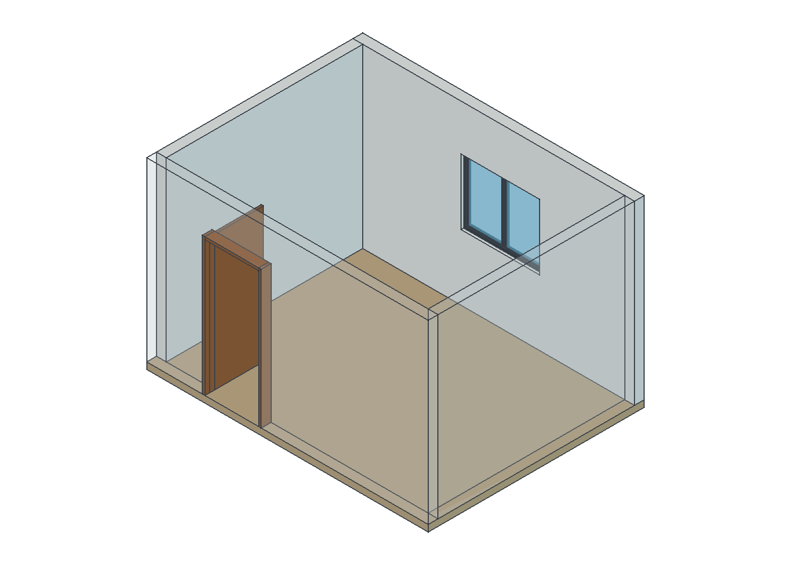

# Cômodo simples — exercício 001

Modelo sintético solicitado pelo usuário em 12/10/2026 e criado no FreeCAD 1.1.4.
Medidas ilustrativas em milímetros, com dimensões internas de 4000 × 3000 mm.

| Elemento | Medida |
| --- | --- |
| Área interna | 12 m² |
| Pé-direito | 2700 mm |
| Espessura das quatro paredes | 150 mm |
| Espessura do piso | 100 mm; topo em Z = 0 |
| Vão da porta | 900 × 2100 mm; folha simplificada aberta em 90° |
| Vão da janela | 1200 × 1000 mm; peitoril de 1000 mm |

## Abrir e explorar

Abra [comodo-001.FCStd](saida-002/comodo-001.FCStd) no FreeCAD.
O modelo contém caixas e cortes nativos Part, organizados nos grupos Arquitetura
e Esquadrias. Não depende de complemento nem de executar a macro para abrir.
As quatro paredes estão completas. A frontal e a direita têm transparência de
82% para facilitar a leitura do interior; não há teto neste exercício.

Para ver o ambiente fechado, selecione as duas paredes, abra a aba Vista e
mude Transparency para 0. Salve qualquer alteração em uma nova revisão.
Use Vista → Vistas padrão → Isométrica e o comando Fit All para enquadrar.

## Reproduzir

Abra [criar-comodo-002.FCMacro](criar-comodo-002.FCMacro) no FreeCAD e use
Macro → Execute Macro (**Ctrl+F6** nesta instalação). **F6 é depuração**.
Cada execução cria a próxima pasta `saida-NNN`, preservando as anteriores.
As dimensões são constantes no início da macro; editar cada peça diretamente
não atualiza automaticamente todas as demais peças.

`criar-comodo-001.FCMacro` é a revisão original preservada para histórico;
não a utilize. Ela falhou ao verificar grupos como se fossem sólidos.
Por isso `saida-001` ficou vazia, e a execução corrigida gerou `saida-002`.

## Evidências e limites

[Manifesto SHA-256](saida-002/manifesto-001.json) e
[registro de verificação](../../docs/FREECAD-COMODO-001.md).
O arquivo foi salvo e reaberto, e os 16 sólidos visíveis passaram na verificação
geométrica. Os cortes da porta/janela foram conferidos por volume e pontos.
A imagem de 1400 × 1000 pixels foi exportada pelo FreeCAD e inspecionada.

Exercício arquitetônico simplificado: não são objetos BIM, não houve exportação
IFC/DXF, e não há cálculo estrutural ou instalação elétrica. Não liberado para
execução ou entrega técnica; revisão e aprovação humanas continuam pendentes.
