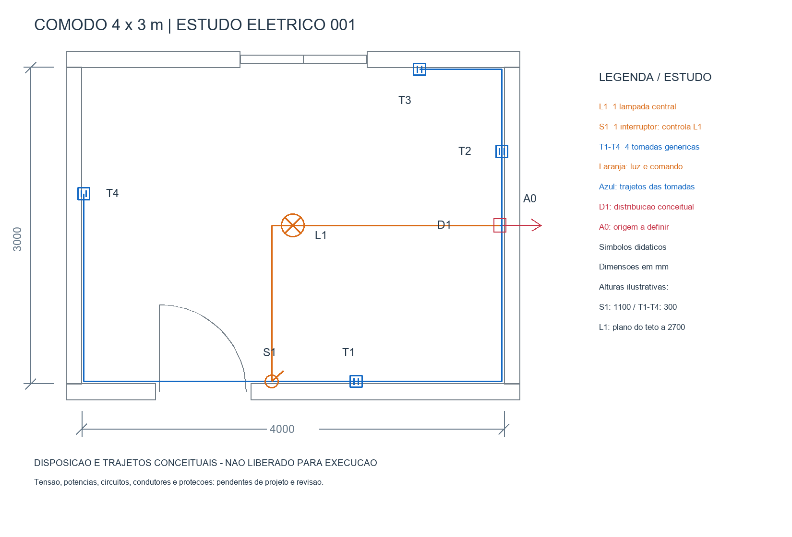
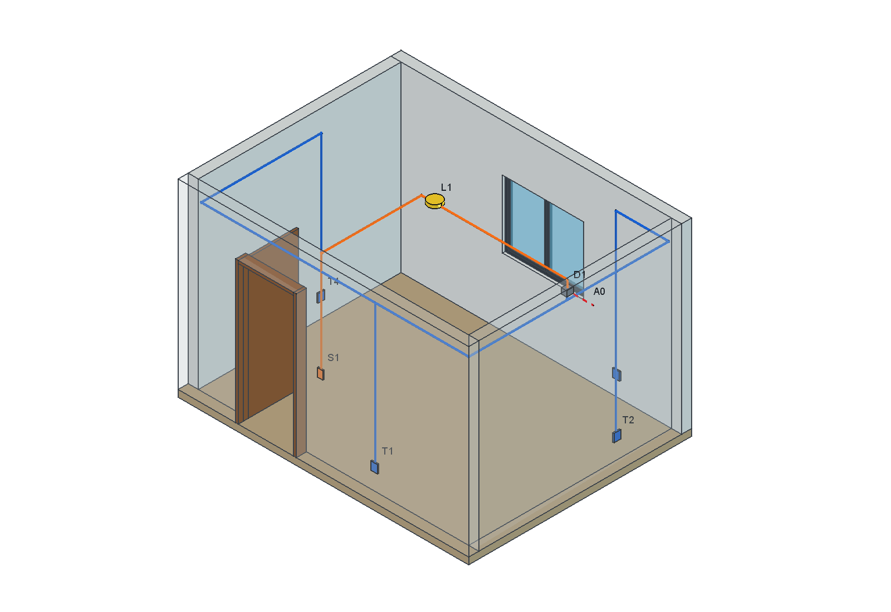

# Instalação do cômodo — estudo elétrico 001

Exercício sintético solicitado pelo usuário em 12/10/2026. Reutiliza uma cópia
do cômodo de 4 × 3 m; a arquitetura original foi preservada por SHA-256.

| Ponto | Representação | Posição/altura ilustrativa |
| --- | --- | --- |
| L1 | Uma lâmpada central | Plano do teto a 2700 mm; desenho da luminária abaixo dele |
| S1 | Um interruptor que controla L1 | Junto ao lado direito da porta; centro a 1100 mm |
| T1 | Tomada na parede frontal | Centro a 300 mm |
| T2 | Tomada na parede direita | Centro a 300 mm |
| T3 | Tomada na parede posterior | Centro a 300 mm |
| T4 | Tomada na parede esquerda | Centro a 300 mm |
| D1 | Referência gráfica de distribuição | Caixa/condições reais de instalação pendentes |
| A0 | Chegada conceitual | Alimentação, origem e quadro a definir |

Quatro tomadas e todas as alturas são hipóteses de demonstração, não resultado
de cálculo normativo. Os símbolos são convenções próprias identificadas pela
legenda. Laranja separa luz/comando e azul separa trajetos das tomadas;
essas cores **não são cores de condutores**. Os percursos não são um esquema
de ligações: fase, neutro, retorno e condutor de proteção ainda não foram desenhados.

## Arquivos para abrir

- [Modelo 3D FreeCAD](saida-002/comodo-eletrico-001.FCStd)
- [Vista isométrica](saida-002/comodo-eletrico-isometrico-001.png)
- [Planta DXF editável no LibreCAD](planta-002/planta-eletrica-001.dxf)
- [Planta vetorial SVG](planta-002/planta-eletrica-001.svg)
- [Lista de pontos CSV](planta-002/lista-pontos-001.csv)
- [Dados comuns: posições e trajetos](pontos-001.json)
- [Manifesto 3D](saida-002/manifesto-3d-001.json) e [manifesto da planta](planta-002/manifesto-planta-001.json)
- [Verificação de integridade](verificar-eletrica-001.py)

O FreeCAD contém grupos de pontos, trajetos e etiquetas. T3/T4 podem ficar
ocultas pelo ângulo inicial e pelas paredes opacas; girar o modelo ou consultar
a planta para ver todos os pontos. Os percursos têm espessura gráfica, sem
diâmetro técnico definido. As propriedades das peças são editáveis; não há
sincronização automática entre alterações manuais do FCStd e do DXF.

No LibreCAD, abrir o DXF e executar `za` (zoom automático) para enquadrar.
O desenho usa geometria 1:1 em mm; a escala da folha de impressão não foi configurada.
Camadas: ARQUITETURA, ILUMINACAO, TOMADAS, PENDENCIAS, TEXTOS e COTAS.

## Reproduzir preservando revisões

Abra [adicionar-eletrica-002.FCMacro](adicionar-eletrica-002.FCMacro) no FreeCAD
e use Macro → Execute Macro (Ctrl+F6 nesta máquina). A macro copia a fonte
preservada, cria a próxima pasta `saida-NNN`, salva/reabre o novo FCStd e exporta
um PNG. A fonte precisa existir em `../comodo-3d-001/saida-002/comodo-001.FCStd`.

Execute [gerar-planta-002.py](gerar-planta-002.py) em Python isolado com Pillow
para criar a próxima pasta `planta-NNN`. Os dois geradores consultam o mesmo
`pontos-001.json`. Alterações futuras devem usar novos arquivos numerados;
ajustar também o verificador para a revisão pretendida.

A primeira tentativa 3D tinha etiquetas grandes demais na exportação. A revisão
002 ajustou a fonte Screen para 18 e encurtou A0. A planta 002 aumentou a margem
do título. Tentativas anteriores permanecem localmente; o GitHub recebe as
revisões finais conferidas.

## Conferência executada e limites

Modelo salvo, reaberto e recomputado no FreeCAD 1.1.4; 41 sólidos válidos,
seis pontos de uso, controle S1/L1 declarado e extremos de sete percursos
conferidos. A arquitetura e a cópia de entrada têm o mesmo SHA-256 da fonte.
PNG 3D e PNG da planta foram inspecionados. O DXF foi aberto e enquadrado no
LibreCAD 2.2.1.5; suas seis camadas e desenho carregaram.

Esta conferência não valida dimensionamento, ligações elétricas, proteção,
coordenação de circuitos ou conformidade. Permanecem pendentes uso do cômodo,
equipamentos, rede de alimentação, tensão, cargas, potência, circuitos,
condutores, proteções, aterramento, condições de instalação e revisão humana.
Não liberado para execução ou entrega como projeto aprovado.
